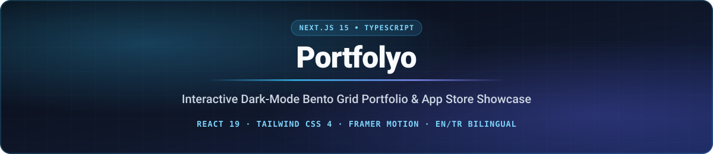

<div align="center">
  
</div>

# Muhammed Buğra Çiftçi — Engineering Portfolio

[](https://github.com/Bugraciftci/Portfolyo/actions/workflows/ci.yml)
[](https://portfolyo-nine-tau.vercel.app)
[](https://nextjs.org/)
[](https://www.typescriptlang.org/)
[](https://tailwindcss.com/)

Dark-mode, Bento Grid engineering portfolio inspired by Apple & Linear design systems — built with **Next.js 15**, **React 19**, **TypeScript**, **Tailwind CSS 4**, and **Framer Motion**.

## Highlights

- **Interactive iPhone 16 Pro Preview & macOS App Dock:** Switch live between flagship App Store apps (*Sunio AI*, *Pinko*, *CS2 Smoke*, *Skincare AI*, *PomoBlock*, *Quittr*) directly in the hero showcase.
- **30+ Live App Store Ecosystem:** Real 1024×1024 App Store artwork, direct store links, and technical architecture tags.
- **Glassmorphic Bento Grid & Spotlight UI:** Cursor-reactive radial spotlight cards and an infinite dual-direction app icon marquee.
- **Architecture & Code Showcase:** Interactive SwiftUI / MVVM / `FamilyControls` / `StoreKit 2` engineering snippets.
- **Bilingual (`EN` / `TR`):** Instant client-side language toggle with zero page reloads.

## Architecture

```text
src/
├── app/
│   ├── globals.css          # Tailwind v4 design tokens & spotlight utilities
│   ├── layout.tsx           # Root metadata, typography & dark surface layout
│   └── page.tsx             # Page composition & language state coordination
├── components/
│   ├── Navbar.tsx           # Floating navigation bar & EN/TR toggle
│   ├── HeroSection.tsx      # Interactive iPhone 16 Pro frame & macOS Dock
│   ├── BentoGridSection.tsx # Engineering metrics, marquee & architecture cards
│   ├── AppShowcaseSection.tsx # Filterable App Store portfolio showcase
│   ├── ResumeSection.tsx    # Experience timeline & downloadable PDF resume
│   └── ContactSection.tsx   # Direct links (GitHub, LinkedIn, X, App Store, Email)
└── data/
    └── portfolioData.ts     # Centralized typed portfolio & localization data
```

## Getting Started

```bash
git clone https://github.com/Bugraciftci/Portfolyo.git
cd Portfolyo
npm install
npm run dev
```

Open `http://localhost:3005` in your browser.

## Build & Typecheck

```bash
npx tsc --noEmit
npm run build
```

## License

MIT — see [LICENSE](./LICENSE).
